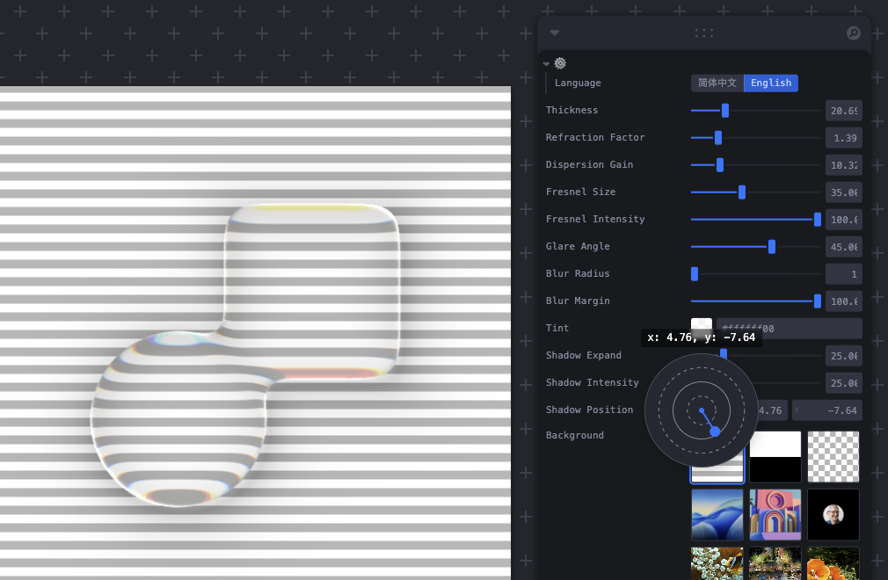
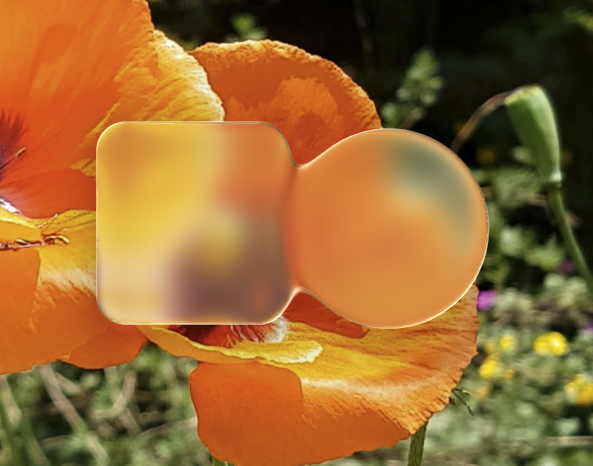
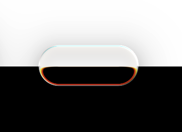
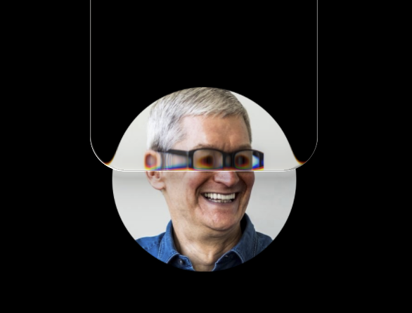

# 🔮 Liquid Glass Studio


[English](README.md) | [简体中文](README-zh.md)

WebGL2 & WebGPU va shaderlar asosida yaratilgan Apple’ning Liquid Glass (suyuq shisha) effektining to’liq veb talqini.
Sozlanadigan parametrlar orqali siz barcha “liquid glass” effektlarini sinab ko‘rishingiz mumkin.

## Online Demo

https://liquid-glass.yinchao.dev/

Xitoylik foydalanuvchilar uchun:
https://liquid-glass.iyinchao.cn/

## Skrinshotlar

<table align="center">
  <tr>
    <td></td>
    <td></td>
    <td></td>
  </tr>
  <tr>
    <td></td>
    <td></td>
  </tr>
</table>

## Asosiy xususiyatlar

**✨ Apple “Liquid Glass” effektlari:**

| Effekt nomi                     | O‘zbekcha ma’nosi              | Qisqacha izoh                                                                                                                                 |
| ------------------------------- | ------------------------------ | --------------------------------------------------------------------------------------------------------------------------------------------- |
| **Refraction**                  | **Yorug‘likning sinishi**      | Nur bir muhitdan boshqasiga (masalan, havodan shishaga) o‘tganda yo‘nalishini o‘zgartiradi — shu tufayli fon egilgan yoki buzilgan ko‘rinadi. |
| **Dispersion**                  | **Ranglarga ajralish**         | Yorug‘lik sinayotganda turli ranglarga (qizil, ko‘k, yashil) ajraladi — kamalak effekti hosil bo‘ladi.                                        |
| **Fresnel Reflection**          | **Aks ettirish kuchi**         | Aks ettirish darajasi burchakka bog‘liq: yon tomondan qaraganda ko‘proq, to‘g‘ridan qaraganda esa kamroq aks etadi.                           |
| **Superellipse Shapes**         | **Yumaloq burchakli shakllar** | Silliq o‘tishli shakllar — iOS ikonkalari kabi tabiiy va estetik ko‘rinadi.                                                                   |
| **Blob Effect (Shape Merging)** | **Shakllarning birlashishi**   | Shaffof shakllar bir-biriga yaqinlashganda suyuq tomchidek qo‘shilib ketadi.                                                                  |
| **Glare**                       | **Yaltirash (porlash)**        | Shisha yuzasida yorqin chiziq yoki nuqta paydo bo‘ladi — uni burchak, rang va o‘lcham bo‘yicha sozlash mumkin.                                |
| **Gaussian Blur Masking**       | **Gauss xiralashtirish**       | Fonni silliq va yumshoq xira qiladi, shisha effekti uchun ishlatiladi.                                                                        |
| **Anti-aliasing**               | **Qirralarni silliqlash**      | Grafika qirralarining tish-tish ko‘rinmasligi uchun ularni silliqlaydi.                                                                       |
| **Dark edges (iOS 27)** **NEW** | **To‘q qirralar** | iOS 27 uslubidagi to‘q qirralar. |


**⚙️ Interaktiv boshqaruvlar:**

- Real vaqt rejimida barcha parametrlarni qulay UI orqali sozlash imkoniyati

**🖼 Fon variantlari:**

- Fon sifatida rasm yoki video ishlatish imkoniyati

**🎞 Animatsiya imkoniyatlari:**

- Bahorgi (spring-based) animatsiyalar — harakatlarni tabiiy ko‘rinishda boshqarish

## Texnik jihatlar

- Yuqori samarali grafikani ta’minlash uchun WebGL2 / WebGPU ikki tomonlama renderlash usuli
- Ko‘p bosqichli renderlash yordamida yuqori sifatli va samarali Gauss xiralashtirish amalga oshiriladi
- SDF shakllar va silliq birlashtirish (smooth) funksiyasidan foydalanish
- Haqiqiy shisha effektlarini yaratish uchun maxsus shaderlar
- Leva UI asosidagi qulay boshqaruv interfeysi

## Boshlash

### Talablar

- Node.js (so‘nggi LTS versiyasi tavsiya etiladi)
- pnpm paket menejeri

### O‘rnatish

```bash
# Barcha kerakli paketlarni o‘rnatish
pnpm install

# Ishga tushirish
pnpm dev

# Ishlab chiqarish (production) uchun build
pnpm build
```

## Rejalashtirilgan ishlar

- [x] Yaltirash (porlash) effektini yanada ko‘proq boshqarish (porlash qanchalik tarqalgan yoki keskin bo‘lishi, rang, o‘lcham va boshqalar).
- [x] O'zingiz xoxlagan fonni yuklash imkoniyati
- [x] WebGPU orqali render qilish
- [ ] Tahrirlash rejimi
- [ ] Shisha matn
- [ ] Shisha uchun tayyor andozalar
- [ ] Shakl yoki obyektning o‘zi yorug‘lik chiqarishi (ya’ni, ichidan porlashi).
- [ ] HDR yoritish
- [x] Parametrlarni import/export qilish
- [x] Render bosqichlarini ko‘rish (Render Step View)
- [ ] Shakl ichida UI kontentni joylashtirish

## Tashakkurlar

Quyidagi manbalar va ilhombaxsh g‘oyalar uchun minnatdorchilik bildiramiz:
- [Inigo Quilez](https://iquilezles.org/) tomonidan yaratilgan [SDF funksiyalari](https://iquilezles.org/articles/distfunctions2d/) va [silliq birlashtirish](https://iquilezles.org/articles/smin/) funksiyasi

- [Adrian Newell](https://unsplash.com/@anewevisual?utm_content=creditCopyText&utm_medium=referral&utm_source=unsplash) tomonidan [Unsplash’da](https://unsplash.com/photos/a-row-of-multicolored-houses-on-a-street-UtfxJZ-uy5Q?utm_content=creditCopyText&utm_medium=referral&utm_source=unsplash) olingan namuna fotosurati (Binolar)

- Tom Fisk tomonidan [Pexels’da](https://www.pexels.com/video/light-city-road-traffic-4062991/) suratga olingan namuna video (Baliq / Transport harakati)

- Pixabay tomonidan [Pexels’da](https://www.pexels.com/video/orange-flowers-856383/) suratga olingan namuna video (Gul)

- Apple va Tim Cook tomonidan taqdim etilgan namuna fotosurati

## Litsenziya

[MIT License](LICENSE)

Ushbu loyiha MIT litsenziyasi ostida tarqatiladi.
Bu shuni anglatadiki, siz koddan foydalanish, uni o‘zgartirish va tarqatish huquqiga egasiz — faqat mualliflikni saqlab qolgan holda.
